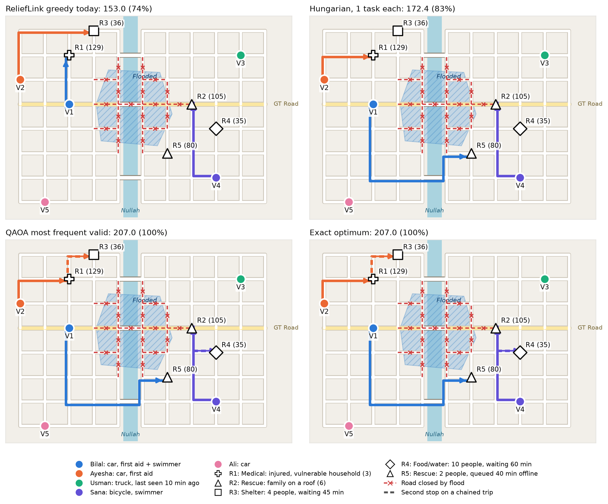
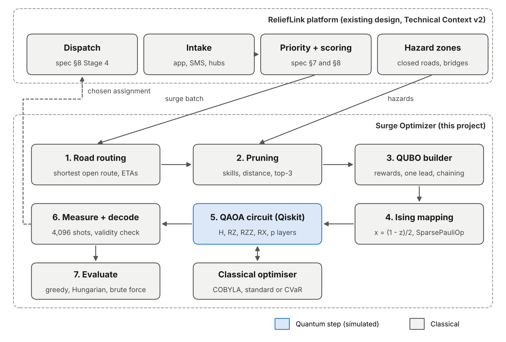

# ReliefLink Surge Optimizer

**Qiskit Fall Fest 2026 Hackathon · Domain: Disaster Response**
**Team:** [Musa Sher and Yahya Kamran]

When a flood hits, help requests arrive in bursts. ReliefLink, our disaster-response platform design for Pakistan, currently matches volunteers **greedily**: it takes requests one at a time in priority order and gives each one its best free volunteer. In a surge this wastes scarce skills. In our test town, greedy sends Bilal, a first-aider who can also swim, to a medical call because he is closest. A rescue that sat queued offline for 40 minutes is then left with no swimmer at all.

We assign all volunteers **jointly**, with travel times routed along a street network where the flood has closed roads and a bridge. We write the problem as a QUBO, solve it with **QAOA** (hand-built in Qiskit 2.x), and check every answer against greedy, the Hungarian algorithm and brute force.



## Results (default scenario: 6 requests, 5 volunteers, 15 qubits, 32,768 possible assignments)

| Method | Assignment | Relief value | % of optimum |
|---|---|---|---|
| Greedy (ReliefLink today) | V1→R1, V2→R3, V4→R2, V5→R6 | 164.3 | 75% |
| Hungarian (1 task per volunteer) | V1→R5, V2→R1, V4→R2, V5→R3 | 190.6 | 87% |
| **QAOA, CVaR, p=4: most frequent measurement** | V1→R5, V2→R1, V2→R3, V4→R2, V4→R4, V5→R6 | **218.3** | **100%** |
| Exact (brute force over 2¹⁵) | V1→R5, V2→R1, V2→R3, V4→R2, V4→R4, V5→R6 | 218.3 | 100% |

| QAOA run | P(valid) | P(exact optimum) | P(≥ 90% of optimum) | Most frequent valid answer |
|---|---|---|---|---|
| CVaR, p = 1 / 2 / 3 | 48% / 72% / 81% | 0.02% / 0.17% / 0.10% | 0.7% / 1.0% / 1.2% | 32% / 26% / 59% of optimum |
| **CVaR, p = 4** | 64% | **1.15%** | 7.6% | **100% (the exact optimum)** |
| CVaR, p = 5 | 73% | 1.81% | 12.2% | 87% of optimum |
| Standard, p = 1 … 5 | 58% … 90% | 0.02% … 0.83% | 0.3% … 6.9% | 26% … 61% of optimum |
| Random guessing | 0.8% | 0.003% | – | – |

All numbers come from `python run_all.py` (seeded, so they reproduce exactly); full tables are in `results/summary.md`.

**What this does and does not show.** At depth 4, CVaR-trained QAOA puts more probability on the exact optimum than on any other of the 32,768 assignments, about 370× more often than random guessing. It does **not** beat brute force: a laptop checks all 32,768 options in well under a second, while training the circuit takes about a minute. We claim a correct quantum formulation that does real work, measured honestly. We do not claim a speedup. See the limitations below.

## Architecture



The full write-up is in `docs/ReliefLink_Surge_Optimizer_Report.docx`, and the video script is in `docs/video_script.md`.

## Where the quantum part is

```
roads + flood ─► routes/ETAs ─► prune ─► QUBO ─► Ising H_C ─► [ QAOA circuit ⇄ COBYLA ] ─► 4,096 shots ─► decode ─► compare
  (classical)    (classical)  (classical) (classical) (classical)        (QUANTUM)            (classical)
```

* **Road network.** The town is a 1 km street grid split by a river with three bridges. Every road segment touching the confirmed flood polygon is closed (18 segments, including the GT Road bridge). ETAs are the shortest open route divided by the spec's flood speeds.
* **One qubit per usable (volunteer, request) pair.** We remove a pair, saving a qubit, if:
  * there is no open road to it;
  * the volunteer lacks a required skill (medical needs first aid, rescue needs a swimmer);
  * the ETA is above 45 minutes;
  * the volunteer is not among the request's top 3 candidates (the spec notifies only the top 3–5).

  That takes 30 pairs down to 15 qubits.
* **Reward** `w_ij = priority_j × score_ij`. Both formulas are copied unchanged from *ReliefLink Technical Context v2* (§7 and §8).
* **Pairwise terms:**
  * a penalty *P* if two volunteers lead the same request;
  * a penalty *P* if one volunteer is given two requests more than 2 km apart by road;
  * a chain cost when one volunteer serves two nearby requests in one trip. This is our extension.
* **Why not just use the Hungarian algorithm?** Without chaining, this is a linear assignment problem, and Hungarian solves it exactly in polynomial time. We say so openly. The chaining terms are **quadratic**, which Hungarian can't represent but a QUBO and QAOA handle naturally.
* **Circuit:** H on all qubits, then *p* layers of `RZ(2γh_i)` + `RZZ(2γJ_ab)` (cost) and `RX(2β)` (mixer). That's 37 RZZ gates per layer.
* **Training:** we grow the circuit one layer at a time. Depth 1 starts from a 12×10 angle grid search; each deeper circuit starts from the previous optimum stretched with INTERP (Zhou et al., 2020), then COBYLA refines it. We compare two objectives: expected energy (standard) and CVaR (best 10% of outcomes).

## Run it

Python 3.10–3.13. On macOS use `python3`.

```bash
git clone <this repo>
cd relieflink-quantum-surge
python3 -m venv .venv
source .venv/bin/activate          # Windows: .venv\Scripts\activate
pip install -r requirements.txt

python -m pytest -q                # 11 tests: spec oracles, flood detour, skill filter, mapping correctness
python run_all.py                  # all results and charts -> results/   (~6 min)
streamlit run app.py               # interactive map demo in the browser
```

`python run_all.py --quick` skips the penalty sweep and scaling study (about 3 minutes).

## Repository layout

| Path | What it is |
|---|---|
| `relieflink_surge/spec.py` | Priority, score and ETA formulas from the ReliefLink spec |
| `relieflink_surge/roads.py` | Town street network, river and bridges, flood closures, shortest routes |
| `relieflink_surge/scenario.py` | The flood-surge instance (R1–R4 are the spec's worked examples A–D, R5 is example F) |
| `relieflink_surge/model.py` | Pruning, QUBO construction, chaining extension, QUBO → Ising |
| `relieflink_surge/qaoa.py` | Hand-built QAOA circuit, layer-by-layer training (standard and CVaR), shot read-out |
| `relieflink_surge/baselines.py` | Greedy, Hungarian, brute force, random |
| `relieflink_surge/plots.py` | Street-map drawing and charts |
| `run_all.py` | Reproduces every number and chart |
| `app.py` | Streamlit demo with the town map |
| `architecture_diagram.py` | Draws `results/architecture.png` |
| `tests/test_all.py` | Spec oracle tests (T1, T5, T8, T20) and mapping correctness checks |
| `results/` | Generated outputs (committed so judges can see them without running) |
| `docs/` | Hackathon report (.docx) and video script |

## Honest limitations

1. **No speedup.** Brute force over 32,768 assignments takes well under a second; training the depth-4 circuit takes about a minute. The statevector simulation itself needs 2ⁿ memory.
2. **Qubits grow as volunteers × requests.** Pruning took 30 pairs down to 15 qubits here, but a district-scale surge would still need hundreds of qubits and much deeper circuits.
3. **Low success rates.** The exact optimum is measured about 1–2% of the time at the best depths. At depth 5 a near-optimal answer (87%) overtakes it as the most frequent. In the scaling study the success rate falls fast with size: ~48% at 4 qubits, ~0.3% at 13 qubits with p=3.
4. **Shallow circuits fail.** At depths 1–3 the most frequent answer is only 26–59% of the optimum. Random starting angles didn't work at 15 qubits at all; the grid start plus INTERP was needed.
5. **Penalty tuning matters and isn't monotone.** At p=3: 1.1× gives the best optimum rate, 1.5× the most valid answers, and 6× is worse on both.
6. **Simulation only, no noise.** CVaR training reads exact probabilities from the statevector. On hardware it would have to be estimated from shots.
7. **Model simplifications.** The town is a synthetic street grid, not real map data; real OpenStreetMap roads would plug into `roads.py`. Other simplifications: a single flood polygon, equipment treated as "not needed" because the spec doesn't define it, and the spec's weights, which it calls unvalidated starting values. Chains of three or more requests are only approximated by pairwise terms (the 2 km leg rule rules them out here).

## Credits

* QAOA: E. Farhi, J. Goldstone, S. Gutmann, *A Quantum Approximate Optimization Algorithm*, arXiv:1411.4028 (2014).
* CVaR objective: P. Barkoutsos et al., *Improving Variational Quantum Optimization using CVaR*, Quantum 4, 256 (2020).
* INTERP initialisation: L. Zhou et al., *Quantum Approximate Optimization Algorithm: Performance, Mechanism, and Implementation on Near-Term Devices*, PRX 10, 021067 (2020).
* Built with Qiskit, SciPy (COBYLA, `linear_sum_assignment`), NetworkX, matplotlib and Streamlit. No code was copied from tutorials. The circuit, QUBO, Ising conversion and road model are written from the formulas above.
* Developed with AI assistance (Claude).
* ReliefLink formulas: our team's *ReliefLink Technical Context v2* design document.

MIT License.
