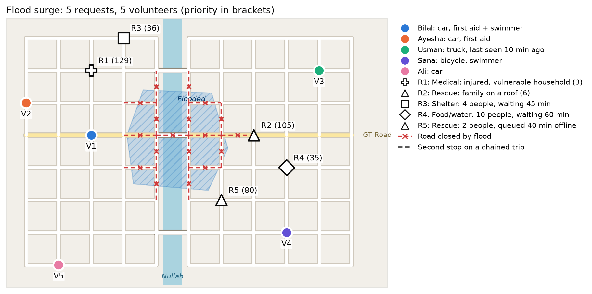

# ReliefLink Surge Optimizer

**Qiskit Fall Fest 2026 Hackathon · Domain: Disaster Response**
**Team:** Musa Sher, Yahya Kamran

## Demostation

https://github.com/user-attachments/assets/3612e13e-f53d-47a0-adef-d9ef16668ac5


When a flood hits, help requests arrive in bursts. ReliefLink, our disaster-response platform design for Pakistan, currently matches volunteers **greedily**: it takes requests one at a time in priority order and gives each one its best free volunteer. In a surge this wastes scarce skills. In our test town, greedy sends Bilal, a first-aider who can also swim, to a medical call because he is closest. A rescue that sat queued offline for 40 minutes is then left with no swimmer at all.

We assign all volunteers **jointly**, with travel times routed along a street network where the flood has closed roads and a bridge. We write the problem as a QUBO, solve it with **QAOA** (hand-built in Qiskit 2.x), and check every answer against greedy, the Hungarian algorithm and brute force.



*Our synthetic flood-hit town. Red dashed lines are roads closed by the flood; numbers in brackets are request priorities.*


## Results (default scenario: 5 requests, 5 volunteers, 10 qubits, 1,024 possible assignments)

| Method | Assignment | Relief value | % of optimum |
|---|---|---|---|
| Greedy (ReliefLink today) | V1→R1, V2→R3, V4→R2 | 153.0 | 74% |
| Hungarian (1 task per volunteer) | V1→R5, V2→R1, V4→R2 | 172.4 | 83% |
| **QAOA, CVaR, p=4: most frequent measurement** | V1→R5, V2→R1, V2→R3, V4→R2, V4→R4 | **207.0** | **100%** |
| Exact (brute force over 2¹⁰) | V1→R5, V2→R1, V2→R3, V4→R2, V4→R4 | 207.0 | 100% |

| QAOA run | P(valid) | P(exact optimum) | P(≥ 90% of optimum) | Most frequent valid answer |
|---|---|---|---|---|
| CVaR, p = 1 / 2 / 3 | 12% / 49% / 14% | 0.4% / 2.6% / 0.9% | 1.4% / 6.7% / 1.5% | 56% / 92% / 82% of optimum |
| **CVaR, p = 4** | 26% | **9.6%** | 12.7% | **100% (the exact optimum)** |
| CVaR, p = 5 | 33% | 9.6% | 11.7% | 66% of optimum |
| Standard, p = 1 … 4 | 69% … 92% | 0.5% … 3.0% | 3.8% … 14.4% | 43% … 79% of optimum |
| **Standard, p = 5** | 91% | 6.2% | 23.7% | **100% (the exact optimum)** |
| Random guessing | 9.3% | 0.1% | – | – |

All numbers come from `python run_all.py` (seeded, so they reproduce exactly; under a minute). Full tables are in `results/summary.md`.

**What this does and does not show.** At depth 4, CVaR-trained QAOA puts more probability on the exact optimum than on any other of the 1,024 assignments, about 98× more often than random guessing. Standard QAOA gets there at depth 5 with far fewer rule-breaking samples. Neither beats brute force, which checks all 1,024 options in about a millisecond. We claim a correct quantum formulation that does real work, measured honestly. We do not claim a speedup. See the limitations below.

## Architecture


The full write-up is in `ReliefLink_Surge_Optimizer_Report.docx`

## Where the quantum part is

```
roads + flood ─► routes/ETAs ─► prune ─► QUBO ─► Ising H_C ─► [ QAOA circuit ⇄ COBYLA ] ─► 4,096 shots ─► decode ─► compare
  (classical)    (classical)  (classical) (classical) (classical)        (QUANTUM)            (classical)
```

* **Road network.** The town is a 1 km street grid split by a river with three bridges. Every road segment touching the confirmed flood polygon is closed (18 segments, including the GT Road bridge). ETAs are the shortest open route divided by the spec's flood speeds.
* **One qubit per usable (volunteer, request) pair.** We remove a pair, saving a qubit, if:
  * there is no open road to it;
  * the volunteer lacks a required skill (medical needs first aid, rescue needs a swimmer);
  * the ETA is above 45 minutes;
  * the volunteer is not among the request's 2 best candidates. The spec notifies the top 3–5; we keep 2 so the circuit stays at 10 qubits.

  That takes 25 pairs down to 10 qubits.

  Ali and Usman end up with no pairs at all, so the circuit chooses between Bilal, Ayesha and Sana.
* **Reward** `w_ij = priority_j × score_ij`. Both formulas are copied unchanged from *ReliefLink Technical Context v2* (§7 and §8).
* **Pairwise terms:**
  * a penalty *P* if two volunteers lead the same request;
  * a penalty *P* if one volunteer is given two requests more than 2 km apart by road;
  * a chain cost when one volunteer serves two nearby requests in one trip. This is our extension.
* **Why not just use the Hungarian algorithm?** Without chaining, this is a linear assignment problem, and Hungarian solves it exactly in polynomial time. We say so openly. The chaining terms are **quadratic**, which Hungarian can't represent but a QUBO and QAOA handle naturally.
* **Circuit:** H on all qubits, then *p* layers of `RZ(2γh_i)` + `RZZ(2γJ_ab)` (cost) and `RX(2β)` (mixer). That's 19 RZZ gates per layer.
* **Training:** we grow the circuit one layer at a time. Depth 1 starts from a 12×10 angle grid search; each deeper circuit starts from the previous optimum stretched with INTERP (Zhou et al., 2020), then COBYLA refines it. We compare two objectives: expected energy (standard) and CVaR (best 10% of outcomes).

## Run it

Python 3.10–3.13. On macOS use `python3`.

```bash
git clone https://github.com/musasher56/Qiskit-Hackathon-Submission.git
cd Qiskit-Hackathon-Submission
python3 -m venv .venv
source .venv/bin/activate          # Windows: .venv\Scripts\activate
pip install -r requirements.txt

python -m pytest -q                # 11 tests: spec oracles, flood detour, skill filter, mapping correctness
python run_all.py                  # all results and charts -> results/   (under a minute)
streamlit run app.py               # interactive map demo in the browser
```

`python run_all.py --quick` skips the penalty sweep and scaling study.

## Repository layout

| Path | What it is |
|---|---|
| `relieflink_surge/spec.py` | Priority, score and ETA formulas from the ReliefLink spec |
| `relieflink_surge/roads.py` | Town street network, river and bridges, flood closures, shortest routes |
| `relieflink_surge/scenario.py` | The flood-surge instance (R1–R4 are the spec's worked examples A–D, R5 is example F) |
| `relieflink_surge/model.py` | Pruning, QUBO construction, chaining extension, QUBO → Ising |
| `relieflink_surge/qaoa.py` | Hand-built QAOA circuit, layer-by-layer training (standard and CVaR), shot read-out |
| `relieflink_surge/baselines.py` | Greedy, Hungarian, brute force, random |
| `relieflink_surge/plots.py` | Street-map and satellite-style drawing, charts |
| `run_all.py` | Reproduces every number and chart |
| `app.py` | Streamlit demo with the town map (street or satellite style) |
| `architecture_diagram.py` | Draws `results/architecture.png` |
| `tests/test_all.py` | Spec oracle tests (T1, T5, T8, T20) and mapping correctness checks |
| `results/` | Generated outputs (committed so judges can see them without running) |

## Honest limitations

1. **No speedup.** Brute force over 1,024 assignments takes about a millisecond; training the circuit takes a few seconds. The statevector simulation itself needs 2ⁿ memory.
2. **Qubits grow as volunteers × requests.** Pruning took 25 pairs down to 10 qubits here, partly by keeping only each request's top 2 candidates, one fewer than the spec's minimum of 3. An earlier 15-qubit version of this instance needed about a minute per training run and reached the optimum only ~1% of the time. A district-scale surge would need hundreds of qubits.
3. **Low success rates and noisy depth trends.** The exact optimum is measured under 10% of the time at the best depths, and progress isn't smooth. For example, CVaR at depth 3 was worse than at depth 2. CVaR circuits also return many rule-breaking samples (only 26% valid at p=4).
4. **QAOA can simply fail.** In the scaling study, on one random 8-qubit instance, it never measured the optimum. Random starting angles also often got stuck; the grid start plus INTERP was needed.
5. **Penalty tuning.** The effect of the penalty weight is small and not monotone (the optimum rate was best at 3×). We kept 1.5×.
6. **Simulation only, no noise.** CVaR training reads exact probabilities from the statevector. On hardware it would have to be estimated from shots.
7. **Model simplifications.** The town is a synthetic street grid, not real map data, and the satellite view is a rendering generated by our code, not imagery. Real OpenStreetMap roads would plug into `roads.py`. Other simplifications: a single flood polygon, equipment treated as "not needed" because the spec doesn't define it, and the spec's weights, which it calls unvalidated starting values.

## Credits

* QAOA: E. Farhi, J. Goldstone, S. Gutmann, *A Quantum Approximate Optimization Algorithm*, arXiv:1411.4028 (2014).
* CVaR objective: P. Barkoutsos et al., *Improving Variational Quantum Optimization using CVaR*, Quantum 4, 256 (2020).
* INTERP initialisation: L. Zhou et al., *Quantum Approximate Optimization Algorithm: Performance, Mechanism, and Implementation on Near-Term Devices*, PRX 10, 021067 (2020).
* Built with Qiskit, SciPy (COBYLA, `linear_sum_assignment`), NetworkX, matplotlib and Streamlit. No code was copied from tutorials. The circuit, QUBO, Ising conversion and road model are written from the formulas above.
* Developed with AI assistance (Claude).
* ReliefLink formulas: our team's *ReliefLink Technical Context v2* design document.

MIT License.
